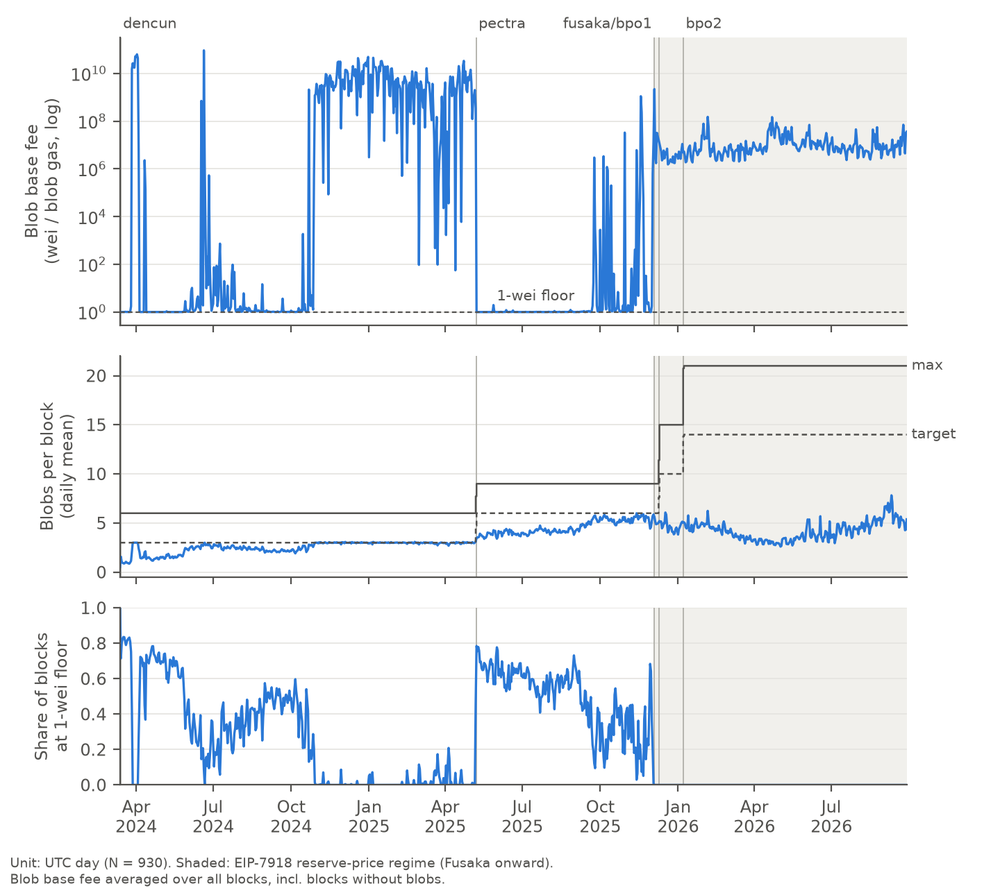
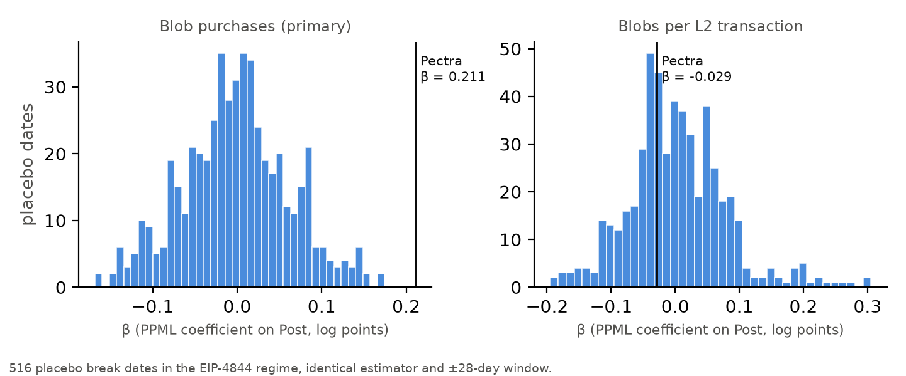
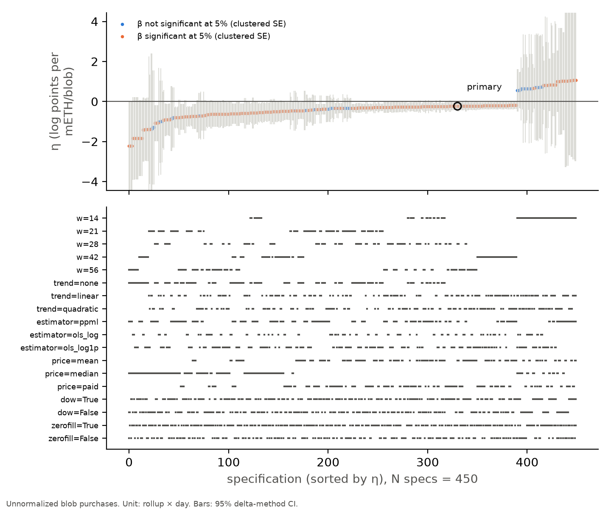
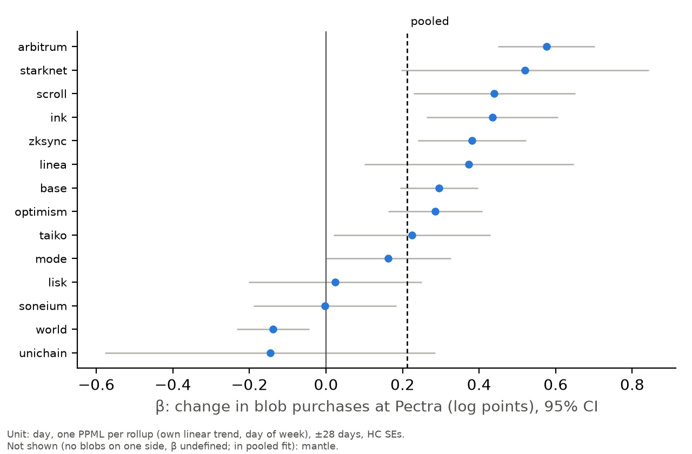
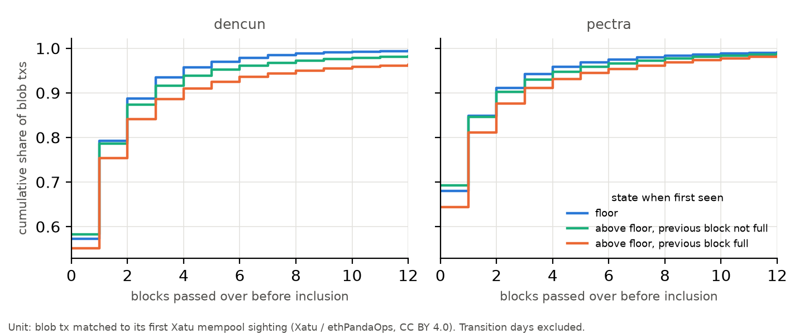
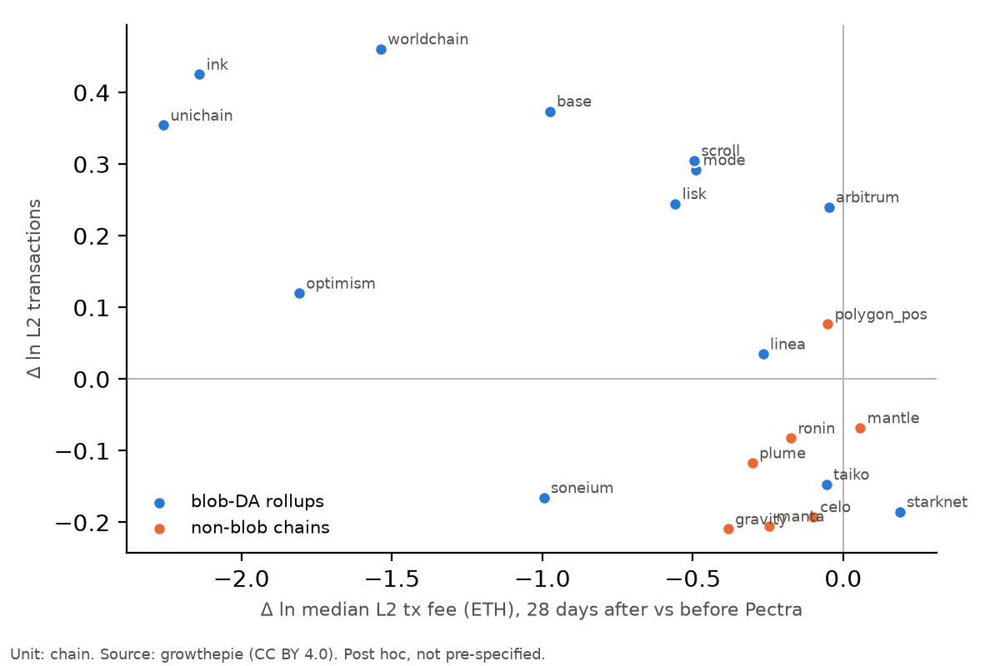
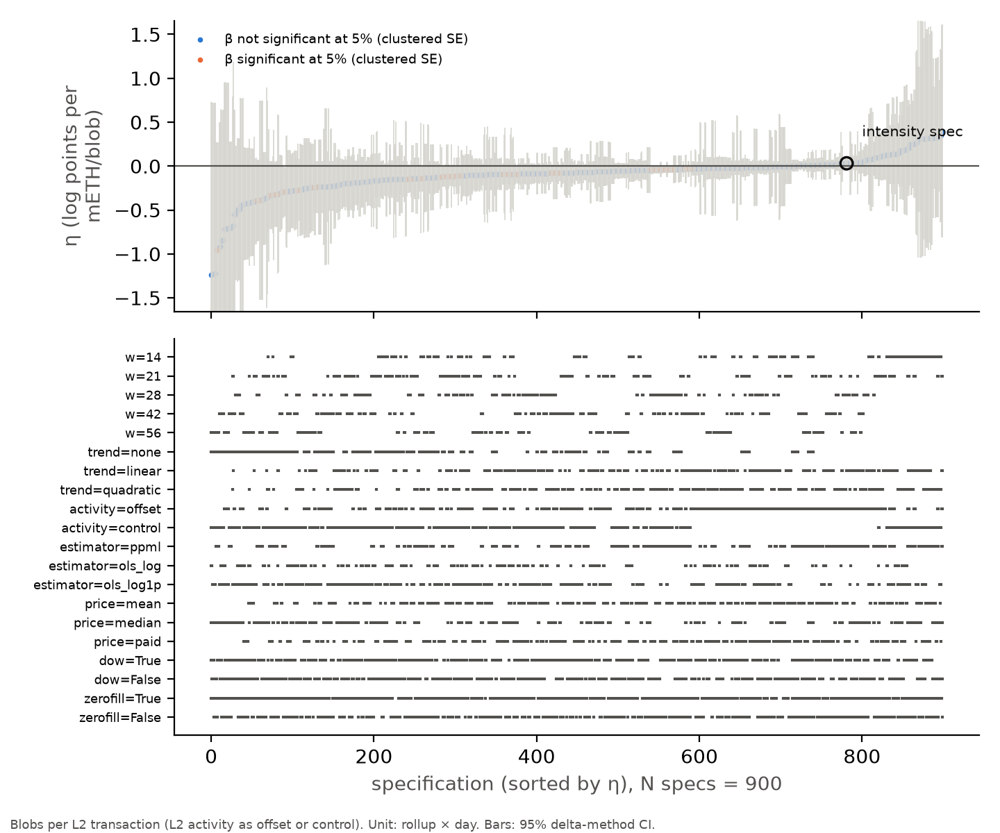

# Abstract

Ethereum sells data-availability capacity to rollups through "blobs" priced by a controller: the blob fee rises
and falls exponentially with cumulative usage above or below a target, and no auction sets it. We measure what
this mechanical price costs. The Pectra upgrade of 7 May 2025 doubled blob capacity on a date fixed weeks in
advance, while the market was congested, and the blob fee fell from {h[l15_p_pre]:.2f} mETH per blob (about
${h[head_usd_pre]:.2f}) to its 1-wei floor. Rollups' blob purchases rose {x[l15_pct]:.0f}%. The 95% interval, built
from the same estimator at {h[n_placebo]} placebo dates, runs from {x[l15_ci_pct_lo]:.0f}% to
{x[l15_ci_pct_hi]:.0f}%, so removing the entire price raised purchases by at most {h[l15_mde_pct_placebo]:.0f}%.
The implied elasticity at the pre-shock price is {h[l15_eps_pre]:.2f}, and no value below
{h[l15_eps_placebo_lo]:.2f} is consistent with the interval. The estimate includes any rise in L2 activity
that coincided with the fork, so it bounds the price response from above. With demand this inelastic, the
controller works mainly as a transfer. Rollups paid ${w[fees_dencun_usd_m]:.1f} million in blob fees under the first
blob regime, {w[fees_cong_share_dencun]:.0%} of it in two quarters when capacity was full and any market-clearing
mechanism would have collected comparable scarcity rents. Where capacity was slack, the reserve price introduced in
December 2025 cost at most {w[dwl_max_eth]:.1f} ETH (${w[dwl_max_usd]:,.0f}) in deadweight loss under the most
elastic demand the data allow. Mempool records for {x[n_matched]:.1f} million blob transactions show that when the
fee sits at its floor, capacity is slack: transactions miss about one block and are almost never priced out.

# 1. Introduction

Since March 2024, rollups have bought their data-availability capacity on Ethereum at a price set by formula. The
EIP-4844 blob market [@eip4844] fixes a target and a maximum number of blobs per block and moves the blob fee
exponentially in the cumulative gap between usage and target. The fee has a floor of 1 wei per unit of blob gas.
In December 2025 a second rule, EIP-7918 [@eip7918], added a reserve price tied to the execution base fee. Neither
rule looks at bids.

Whether it matters that a price is mechanical depends on one number, the price elasticity of demand. If demand is
elastic, a mis-set price changes who gets capacity and how much of it is used, and the welfare cost is
allocative. If demand is inelastic, the same mis-set price changes mostly who pays, and the cost is a transfer.
This paper estimates that elasticity and turns it into a welfare accounting.

Estimating it is harder than the volume of on-chain data suggests. The blob fee is common to every buyer in a
block, so cross-sectional comparisons carry no price variation, and day fixed effects absorb all of it. Within a
regime the fee is an outcome of demand by construction. For long stretches it sits at a floor of 1 wei, where a
log-price elasticity is not economically meaningful. We therefore use a scheduled supply shock. The Pectra upgrade
[@eip7691] doubled the blob target from 3 to 6 per block on 7 May 2025, a date fixed by client releases weeks
earlier, at a time when usage had been at target for months. The fee fell from {h[head_p_pre]:.2f} mETH per blob
to the floor within a day.

We fixed the specification in writing and committed it before estimating it (commit `811ab9b` in the replication
repository), and we report every judgement call in a public decision log together with a specification curve.
That specification named blobs per L2 transaction as the headline outcome. The data later showed that L2 activity
itself responded to the fork, which makes that outcome a poor measure of the price response; we promoted the
unnormalized specification, listed in the same document, to primary and recorded the revision and its reason
alongside the original text (Section 6.2).

The paper makes five contributions.

**1. A bound on the demand elasticity for blob capacity.** When the price of a blob fell from about
${h[head_usd_pre]:.2f} to zero, rollups' blob purchases rose {x[l15_pct]:.0f}%, and the reported interval rules out
increases larger than {h[l15_mde_pct_placebo]:.0f}%. The elasticity at the pre-shock price is {h[l15_eps_pre]:.2f},
with an elastic bound of {h[l15_eps_placebo_lo]:.2f}. Blobs bought per L2 transaction did not change
({x[head_pct]:.1f}%), so the rise came through L2 activity. A price cut of 100% leaves little room for the
objection that the sample lacks variation.

**2. A welfare decomposition that separates transfers from allocative loss.** Rollups paid
{w[fees_dencun_eth]:,.0f} ETH (${w[fees_dencun_usd_m]:.1f} million) in blob fees under the first regime.
{w[fees_cong_share_dencun]:.0%} of this fell in 2024-Q4 and 2025-Q1, when usage averaged {w[cong_util]:.0%} of
target and the binding constraint was capacity. In slack periods the fee is either at a
floor worth nothing or at a reserve whose deadweight loss is at most {w[dwl_max_eth]:.1f} ETH over
{w[reserve_days]} days.

**3. Evidence that the floor regime is slack capacity, which corrects a natural reading of the mechanism.** A fee
pinned at its floor looks like a price that has failed to clear the market, and one might expect allocation by
queue. We match {x[n_matched]:.1f} million blob transactions to their first sighting in the public mempool.
Transactions first seen at the floor miss {mp[dencun_floor_mean_passed_over]:.2f} blocks on average in the first
regime, the fewest of any state, and {mp[dencun_floor_share_passed_blocks_priced_out]:.2%} of the blocks they miss
price them out.

**4. Two identification strategies that fail for mechanical reasons.** The later capacity increases, BPO1 and
BPO2 [@eip7892], have no first stage: usage was already below target and the reserve set the price. Variation in
the execution base fee cannot satisfy the exclusion restriction for the blob price, because every blob rides in a
transaction that pays execution gas at that same base fee. Reporting both saves other researchers the attempt.

**5. Verification of the blob schedule from the protocol's own update rule.** We recompute the excess-blob-gas
state of all {x[n_blocks_checked]:,} blocks from their parents. Each regime's rule explains every block, and the
rules separate the regimes: the EIP-4844 rule mispredicts {fr[fusaka_share_mismatch_under_4844_rule]:.1%} of blocks
after the Fusaka upgrade, although Fusaka left the blob target and maximum unchanged.

# 2. Related literature

The closest economic literature studies transaction-fee mechanisms. @roughgarden2020 and @roughgarden2024 analyse
EIP-1559 [@eip1559], the execution-gas analogue of the blob controller, as a mechanism design problem, asking
whether users, block producers and coalitions have incentives to follow it. @ferreira2021 study dynamic
posted-price mechanisms for the same market, and @leonardos2021 study the dynamics of the base-fee update rule.
Empirical work on EIP-1559 by @reijsbergen2021 and @liu2022 measures fees and waiting times after its introduction.
In Bitcoin, @huberman2021 model fees as the price users pay to avoid delay when capacity is fixed, and
@easley2019 trace how fees evolved as block rewards fell. Our setting differs in two respects. The buyers number a few
dozen rollups, and the product is data capacity that rollups must buy to settle their own
customers' transactions. The question also differs: we ask what the mechanical price costs, which requires the
demand elasticity, and prior work does not estimate it for blobs.

Work on the blob market itself is recent. @crapis2023 analyse the economics of EIP-4844 and rollups' posting
strategies, including sharing blobs. @mamageishvili2023 derive batch-posting strategies for rollups facing a
variable base-layer price. @park2024 describe the first months of the blob market, including rollup transaction
dynamics and the blob fee. @albassam2018 set out the data-availability problem that makes rollups buy this
capacity at all. We add a design-based elasticity estimate and a welfare accounting built on it.

The welfare question connects to the comparison of prices and quantities as control instruments [@weitzman1974]
and to the empirical comparison of posted prices and auctions [@einav2018]. The blob controller is a hybrid: a
quantity target enforced by a price that adjusts with a lag. Our finding that demand is inelastic places it in the
region where the choice of instrument matters for revenue and volatility much more than for allocation.

On method, we follow the regression-discontinuity-in-time literature on short windows and trend flexibility
[@hausman2018], estimate count outcomes by Poisson pseudo-maximum likelihood [@santossilva2006], base inference
for a single event on placebo dates [@conley2011], report wild cluster bootstraps for few clusters
[@cameron2008; @kline2012; @mackinnon2017; @roodman2019], and summarise sensitivity with a specification curve
[@simonsohn2020].

# 3. Institutional setting

A blob is 131,072 units of blob gas, or 128 KiB of capacity that consensus nodes keep for about 18 days. Rollups
buy blobs in type-3 transactions and post their compressed transaction data into them. We measure quantities as
blobs purchased, which is capacity bought: a rollup pays for a whole blob whether it fills it or not.

Each block header records the excess blob gas, the cumulative usage above target carried forward from earlier
blocks. The blob fee is the exponential of the excess divided by an update fraction, with a floor of 1 wei per
unit of blob gas. In the first regime, Dencun (13 March 2024 to 7 May 2025), the target was 3 blobs and the maximum
6. Pectra raised them to 6 and 9 [@eip7691]; the same upgrade repriced calldata [@eip7623]. Fusaka (3 December 2025)
kept 6 and 9 and introduced EIP-7918: when the execution cost of a blob exceeds its blob fee, the excess can no
longer fall, which puts a floor under the blob fee at roughly one sixteenth of the execution base fee per unit of
blob gas. Two blob-parameter-only upgrades followed, BPO1 (9 December 2025; 10 and 15) and BPO2 (7 January 2026;
14 and 21).

Two facts from the protocol matter for the analysis. The header-implied fee is valid in every regime, because
EIP-7918 changes only how the excess evolves and the fee is computed from the excess as before; it matches the fee paid within 0.1%
or 1 wei for {a[price_agree_share]:.1%} of {a[n_blob_txs_dated]:,} blob transactions. And the regimes are
identified exactly by the update rule (Appendix A).

# 4. Data

The data combine five sources. Block headers from Dencun activation onward, collected over public JSON-RPC,
supply the fee state and blob usage of every block. Every blob-carrying transaction comes from the Blobscan index
[@blobscan]; rollup labels come from Blobscan and the blob-list registry [@bloblist], released under CC0. Daily L2 activity, including transaction counts and median transaction fees,
comes from growthepie [@growthepie], published under CC BY 4.0. First mempool sightings of blob transactions for
the Dencun and Pectra regimes come from the Xatu sensor network of ethPandaOps [@xatu], also CC BY 4.0. ETH/USD
closes come from Binance, with Coinbase as fallback. The deposited dataset is described in Section 13.

Rollup labels leave {a[unk_blobs_ALL]:.1%} of blobs unattributed. The share is larger by other measures,
{a[unk_tx_ALL]:.1%} of blob transactions and {a[unk_fees_ALL]:.1%} of fees, and it varies by regime from
{a[unk_blobs_pectra]:.1%} of blobs under Pectra to {a[unk_blobs_bpo1]:.1%} under BPO1. Unattributed demand enters
every aggregate and is excluded from rollup-level regressions, where a residual category has no meaningful fixed
effect; including it as one more unit changes the levels estimate from {h[s1_beta]:.3f} to {h[s1b_beta]:.3f}.

Celestia and EigenDA enter only through growthepie's daily aggregates. Rollup-level usage of these alternative
layers is not observable here (Section 12).

# 5. Descriptive facts

Table 1 and Figure 1 describe the market. Three features shape the analysis.

The floor is common but not universal. The fee sat at 1 wei in {d[dencun_share_blocks_at_floor]:.1%} of Dencun
blocks and {d[pectra_share_blocks_at_floor]:.1%} of Pectra blocks, and in none after Fusaka.

The first regime had two phases. Through 2024-Q3 usage was mostly below target and the fee mostly at the floor;
fees for all of 2024-Q3 came to {w[fees_2024q3_eth]:.6f} ETH. From October 2024 until Pectra, usage sat at
{w[cong_util]:.0%} of target and the daily mean fee averaged {w[cong_mean_p]:.2f} mETH per blob with a standard
deviation of {w[cong_sd_p]:.2f}. We split the regime by calendar quarter only; floor incidence is an outcome and
cannot define a sample.

After Fusaka the reserve set the price. Usage fell to {d[bpo1_utilization_vs_target]:.0%} of target under BPO1 and
{d[bpo2_utilization_vs_target]:.0%} under BPO2, yet the fee never touched the floor, and the reserve governed the
update in {fr[bpo2_share_mismatch_under_4844_rule]:.0%} of BPO2 blocks.

{tbl[t1]}

# 6. Identification and estimation

## 6.1 The supply shock

Pectra is the only upgrade in the sample that moved the price materially. In the 28 days before it, usage was at
target and the mean fee was {h[head_p_pre]:.2f} mETH per blob; in the 28 days after, the fee was at the floor. The
first stage, a day-level regression of the fee on a post-fork indicator with a trend and day-of-week effects, gives
a change of {h[head_pi]:.2f} mETH per blob (Newey-West SE {h[head_se_pi]:.2f}). Blob capacity cannot be stored, so
demand on either side of the fork is not shifted by the fork itself; we drop the fork day.

The pre-shock daily fee ranged from 0 to {h[ev_pre_p_max]:.2f} mETH per blob, so the estimates speak to prices in
that range. Only {h[ev_n_days_above]} days of the first two regimes had a higher daily fee, but those days carried
{h[ev_share_fees_above]:.0%} of all fees paid in the two regimes. Outside that range our bound does not apply.

## 6.2 Estimating equations

The unit of observation is a rollup-day. Let $B_{{it}}$ be blobs bought by rollup $i$ on day $t$, zero-filled between
its first and last post, and $T_{{it}}$ its L2 transactions. We estimate by Poisson pseudo-maximum likelihood

$$E[B_{{it}}] = T_{{it}}^{{\,k}} \exp(\alpha_i + \gamma_i t + \delta_{{w(t)}} + \beta\, \mathrm{{Post}}_t),$$

with rollup fixed effects $\alpha_i$, rollup-specific linear trends $\gamma_i t$ and day-of-week effects
$\delta_{{w(t)}}$, over 28 days either side of the fork. The primary specification sets $k = 0$: the outcome is blob
purchases of the {h[l15_n_rollups]} rollups for which daily L2 transaction counts exist. We also report it for all
{h[s1_n_rollups]} labelled rollups.

The specification we committed before estimation set $k = 1$, entering L2 transactions as an offset so that the
outcome is blobs per L2 transaction. We chose it because ETH rose 22% the day after Pectra, which plausibly raised
L2 activity at the moment the fee fell, and we assumed that blob costs were too small to move L2 activity
themselves. That assumption failed (Section 11): L2 activity on blob-buying chains rose relative to chains that do
not buy blobs, so the denominator responds to the treatment. We therefore report the per-transaction outcome as a
descriptive measure of the intensity margin and use $k = 0$ for inference about demand. Everything else in the
specification is as committed. The cost of the change is that the primary estimate also contains any L2 activity
raised by the ETH rally, which biases it toward a larger response; we read it as an upper bound on the price
response.

The semi-elasticity is $\eta = \beta/\pi$, where $\pi$ is the first stage, in log points per mETH per blob, and
the elasticity at the pre-shock price $\bar p$ is $\eta \bar p$. We measure the price in mETH per blob. A
log-price coefficient identified off a move to the floor depends on where the floor happens to be: for the
intensity outcome the same $\hat\beta$ gives {h[s5_elast_floor_1]:.4f} with the actual 1-wei floor and
{h[s5_elast_floor_1000000]:.4f} if the floor were $10^6$ wei. Table 2 reports the log-price coefficient for
completeness.

## 6.3 Inference with one event and few clusters

The design rests on one event, so standard errors clustered by rollup describe cross-rollup noise but not the risk
of a common shock on the fork date. Our reported intervals therefore come from placebo dates [@conley2011]: we
apply the identical estimator at each of {h[n_placebo]} placebo break dates between {h[placebo_lo]} and
{h[placebo_hi]} whose windows exclude Pectra, and invert the distribution of placebo coefficients. For the primary
specification the placebo standard deviation of $\hat\beta$ is {h[placebo_sd_l15]:.3f}, against a clustered
standard error of {h[l15_se_beta_rollup]:.3f}. The minimum detectable effect of the design, 2.8 placebo standard
deviations (80% power against a 5% two-sided test), is {h[l15_mde80_pct]:.0f}%.

Clustering by rollup has a second problem. A few rollups supply most of the blob volume: in the primary
specification Base carries {h[l15_top_cluster_score_share]:.0%} of the variance of the score, and in the intensity
specification {h[head_top_cluster_score_share]:.0%}. We report the restricted wild score bootstrap of @kline2012,
the maximum likelihood analogue of the wild cluster bootstrap-t, enumerating all 32,768 Rademacher sign vectors for
15 clusters. In a simulation with 15 equal clusters and common day shocks it rejects a true null at 7.3% with a
nominal 5% level.

The two procedures address different problems, and they can disagree. The wild bootstrap corrects the bias of
clustered standard errors when clusters are few and unequal: it takes the fork date as given and draws its
uncertainty from the dispersion of rollup-level responses, which is wide when one rollup dominates. Placebo dates
address the threat that matters most with a single treatment date, a shock common to all rollups that happens to
coincide with the fork. They measure how often the same estimator, applied to dates with no fork, produces a
coefficient as large, and that distribution already includes the cross-rollup noise at those dates. It assumes the
placebo dates are exchangeable with the fork date. We report the placebo interval in the abstract and in the text,
and the wild bootstrap and clustered intervals beside it in Table 2.

# 7. Results: a bound on the elasticity

Table 2 reports the estimates.

{tbl[t2]}

Blob purchases of the 15 rollups rose {x[l15_pct]:.0f}% when the fee fell to the floor (column 1). The reported
interval runs from {x[l15_ci_pct_lo]:.0f}% to {x[l15_ci_pct_hi]:.0f}%, and no placebo date produced a coefficient
as large (permutation p below {x[pinv]:.3f}; Figure 2). Removing a price of ${h[head_usd_pre]:.2f} per blob raised
purchases by at most {h[l15_mde_pct_placebo]:.0f}%. The minimum detectable effect of the design, at 80% power, is
{h[l15_mde80_pct]:.0f}%, so an increase of the size we estimate is within what the design can detect. Under
exponential demand the estimate implies a semi-elasticity of {h[l15_eta]:.3f} per mETH per blob and an elasticity
at the pre-shock price of {h[l15_eps_pre]:.2f}; the elastic end of the interval implies {h[l15_eps_placebo_lo]:.2f}.
Across all {h[s1_n_rollups]} labelled rollups (column 2) purchases rose {x[s1_pct]:.0f}%.

The wild bootstrap interval for column 1, {x[l15_wild_lo_pct]:.0f}% to {x[l15_wild_hi_pct]:.0f}%, does not exclude
zero. For the reasons in Section 6.3 we report the placebo interval: with one treatment date the main risk is a
common shock, which the placebo dates measure directly. The two procedures disagree about significance and agree
on magnitude. Neither interval contains an elasticity above 1 in absolute value.

Blobs bought per L2 transaction changed by {x[head_pct]:.1f}% (column 3), with a reported interval from
{x[head_lo_pct]:.1f}% to {x[head_hi_pct]:+.1f}%. We do not read this as a price response, because the denominator
moved with the treatment. It says where the rise in purchases came from: rollups bought more blobs because they
carried more L2 transactions, and the capacity bought per transaction stayed the same.

**Specification curve.** Across {sc[prim_n_specs]} specifications of the primary outcome that vary the window,
trends, the estimator, the price measure, day-of-week effects and zero-filling, the median elasticity at the
pre-shock price is {sc[prim_eps_median]:.2f}, and the 5th to 95th percentile range is {sc[prim_eps_p05]:.2f} to
{sc[prim_eps_p95]:.2f} (Figure 3). No specification implies an elasticity above 1 in absolute value.
{sc[prim_share_eps_pos]:.0%} have the wrong sign; all of them use the 14-day window, and none of the specifications with
longer windows does. The primary estimate is less elastic than
{sc[prim_pctile]:.0%} of the curve. The per-transaction curve (Appendix Figure 7) is centred near zero: its median
elasticity is {sc[int_eps_median]:.3f}.

**Heterogeneity.** Estimated one rollup at a time, {sc[het_n_pos]} of {sc[het_n]} rollups increased their
purchases; the equal-weighted mean is {sc[het_mean_beta]:.3f} log points and Base's is {sc[het_base_beta]:.3f}
(Figure 4). For blobs per L2 transaction the per-rollup estimates split, {sc[het_int_n_pos]} positive, with an
equal-weighted mean of {sc[het_int_mean_beta]:.3f}.

**A second source of evidence.** In the congested quarters the daily fee had a standard deviation of
{w[cong_sd_p]:.2f} mETH per blob while usage stayed near target. If demand shifts were as volatile as detrended L2
activity, whose standard deviation was {w[l2_resid_sd]:.1%}, a fee clearing fixed capacity would move by that
amount divided by the semi-elasticity. The implied semi-elasticity is {w[implied_eta]:.3f} per mETH per blob, less
elastic than our primary estimate. The elastic tail of the primary curve, near {w[eta_3]:.2f}, would require daily
demand shifts with a standard deviation of {w[implied_shift_sd_p5]:.0%}. This check is a calibration, and it
points toward demand at least as inelastic as we estimate.

**Fusaka.** The reserve's introduction raised the fee from zero to {h[s2_p_post]:.3f} mETH per blob (about
${x[s2_usd]:.2f}) for the five days before BPO1; blob purchases per L2 transaction changed by {h[s2_beta]:.3f} log
points (two-way SE {h[s2_se_beta_twoway]:.3f}). Five days and a price change of that size add little information.

# 8. The floor regime is slack capacity

A fee pinned at 1 wei looks like a price that has failed to clear, and a natural reading is that allocation then
happens by queue. The protocol logic says otherwise. The fee reaches the floor only after usage has run below
target, so capacity is left over, and any rollup willing to pay 1 wei can be served. Queueing should appear
instead when demand jumps faster than the exponential fee can follow and blocks fill.

We test this with {x[n_matched]:.1f} million blob transactions matched to their first mempool sighting,
{mp[match_dencun]:.0%} of Dencun and {mp[match_pectra]:.0%} of Pectra blob transactions. The {x[n_mempool]:.1f}
million first seen before inclusion enter the analysis; the rest were first seen after inclusion, a sign of sensor
lag. For each we count the
blocks proposed between first sighting and inclusion and classify the state the transaction faced using only
information fixed before it could be included: whether the next block's fee was at the floor, and whether the
preceding block was full.

{tbl[t3]}

Transactions first seen at the floor wait the least (Table 3 and Figure 5). In Dencun they missed
{mp[dencun_floor_mean_passed_over]:.2f} blocks on average, against {mp[dencun_cong_mean_passed_over]:.2f} when the
previous block was full, and {mp[dencun_floor_share_passed_blocks_priced_out]:.2%} of the blocks they missed priced
them out. Within rollup and day, the floor changed the probability of missing the first eligible block by
{mp[reg_dencun_waited_b_floor]:+.3f} (SE {mp[reg_dencun_waited_se_floor]:.3f}) in Dencun and
{mp[reg_pectra_waited_b_floor]:+.3f} (SE {mp[reg_pectra_waited_se_floor]:.3f}) in Pectra, against base rates of
{mp[reg_dencun_waited_mean_base]:.2f} and {mp[reg_pectra_waited_mean_base]:.2f}.

Missing the first block is common in every state. Our definition of the first eligible block allows no time for
block building, so part of the base rate is mechanical. Of the delayed floor transactions, {x[floor_full_share]:.0%} met at least
one full block: usage arrives in bursts, and a block can fill even when the running excess is zero. The delay in
those cases is about one block, 12 seconds. Pricing out is a feature of congestion. In congested Dencun states
{mp[dencun_cong_share_passed_blocks_priced_out]:.0%} of missed blocks priced the transaction out.

# 9. Welfare: transfer and allocative loss

The elasticity bound decides the welfare accounting. We model demand as exponential in the fee, $Q(p) = A
e^{{\eta p}}$, calibrated each day to the observed fee and quantity.

**Slack capacity.** When usage is below target the protocol treats the marginal cost of capacity as zero, and any
positive fee excludes some purchases worth less than the fee. At the 1-wei floor that loss is zero to machine
precision. Under the EIP-7918 reserve, when usage averaged {w[reserve_util]:.0%} of target, the loss is the
triangle between the demand curve and the fee. Table 5 evaluates it at the primary estimate, at the elastic ends
of the reported intervals and at the 5th percentiles of the specification curves. At the primary point estimate it
is {w[dwl_point_eth]:.2f} ETH (${w[dwl_point_usd]:,.0f}) over {w[reserve_days]} days, and at the elastic end of the
primary interval {w[dwl_ci_eth]:.2f} ETH (${w[dwl_ci_usd]:,.0f}). Even at the most elastic value in the table it
is {w[dwl_max_eth]:.2f} ETH (${w[dwl_max_usd]:,.0f}), or {w[dwl_max_share]:.0%} of the fees collected under the
reserve.

**Binding capacity.** In 2024-Q4 and 2025-Q1 capacity was full and rollups paid {w[fees_cong_eth]:,.0f} ETH
(${w[fees_cong_usd_m]:.1f} million), {w[fees_cong_share_dencun]:.0%} of all Dencun fees. With capacity fixed at
target, some mechanism has to decide who posts, and a uniform-price auction for the same capacity would clear
where demand meets the target. On average the controller did the same: usage was {w[cong_util]:.0%} of target. The
fees were scarcity rents on fixed capacity, burned by the protocol, and an auction would have collected rents of
similar size. What the controller adds is lag and overshooting. With demand this inelastic, any mechanism that
clears fixed capacity produces a volatile price, and we do not separate the controller's contribution from that of
demand.

**Capacity.** Pectra cut fees from {w[pectra_fee_pre_eth_day]:.1f} ETH per day (${w[pectra_fee_pre_usd_day]:,.0f})
to effectively zero while purchases rose {x[l15_pct]:.0f}%. The largest price episode in the sample ended
with a capacity increase, and the transfer ended with it.

{tbl[t4a]}

{tbl[t4b]}

# 10. Two strategies that fail

**Later capacity increases.** BPO1 and BPO2 raised the target to 10 and then 14 blobs. By then usage was well
below target and the fee was set by the reserve, so extra capacity could not lower it: the mean fee in the 28 days
around BPO2 was of the order of 0.001 mETH per blob on both sides. A capacity shock identifies a demand curve only
if it moves the price. These two did not.

**Execution base fee as an instrument.** After Fusaka the reserve ties the blob fee to the execution base fee, and
one might use spikes in the base fee from activity unrelated to rollups, such as token launches, as an instrument.
The exclusion restriction fails before any argument about correlated demand. Every blob is carried by a type-3
transaction that pays execution gas at the same base fee, so the base fee raises the cost of posting through the
carrier transaction as well as through the reserve, and both channels are proportional to it. At most, base-fee
variation identifies the response to the full cost of a post. Even that version fails in our data. Within a day,
with rollup-by-day and rollup-by-hour-of-day fixed effects, blob purchases rise by {ix[beta_blobs]:.3f} log points
(SE {ix[se_blobs]:.3f}, N = {ix[n_obs]:,.0f} rollup-hours) for each log point of base fee. A cost response would have
the opposite sign; the estimate is what one expects if busy hours on the base layer are also busy hours on
rollups.

# 11. Exploratory analysis: pass-through to L2 users (post hoc)

This section was not part of the specification fixed before estimation. We added it after the data contradicted
an assumption behind that specification, namely that blob costs are too small to affect L2 fees. They are not, and
this is the finding that led us to change the primary outcome (Section 6.2). Before Pectra,
blob cost per L2 transaction on OP Stack chains was of the same order as the entire median L2 fee. We treat what
follows as motivation for a separate, pre-specified study.

We compare {pt[n_treated]} rollups that buy blobs with {pt[n_control]} L2s and sidechains that do not, with chain
and day fixed effects over the same window (N = {pt[n_obs]:,} chain-days). Day effects absorb the ETH rally. Blob
users' median L2 fees changed by {x[fee_pct]:.0f}% relative to the comparison chains (SE {pt[se_fee]:.2f} log points,
placebo p = {pt[p_fee]:.2f}), and their L2 transactions rose {x[act_pct]:.0f}% (SE {pt[se_act]:.2f} log points,
placebo p = {pt[p_act]:.2f}). Within blob users, activity rose more where fees fell more: the slope is
{pt[dose_b]:.3f} (SE {pt[dose_se]:.3f}, N = {pt[dose_n]} chains). Figure 6 plots the chain-level changes.

The pattern fits demand for blobs derived from demand for L2 transactions, with the price passed through to L2
users. The evidence is thin. It rests on one event, the activity effect clears the placebo distribution only at
the 10% level, most comparison chains use their own gas tokens, and OP Stack's Isthmus upgrade arrived the same
week. A second supply shock in a congested market, or rollup-level fee data at higher frequency, would settle it.
If the channel is real, it accounts for the rise in blob purchases in Table 2 and makes blob demand derived
demand: rollups pass the price on, and their users decide how much capacity is bought. Its implied semi-elasticity
of {pt[eta_activity_margin]:.2f} per mETH per blob is less elastic than values already in Table 5, so the welfare
accounting does not change. We do not treat this as a second finding. It is the open question with which the paper
ends.

# 12. Limitations

The design rests on a single event. Placebo dates measure how unusual the estimate is, but they cannot rule out a
shock specific to 7 May 2025. The ETH rally that began the next day is one such shock; it would raise L2 activity
and blob purchases, which is why we read the primary estimate as an upper bound on the price response. Pectra also raised the cost of calldata [@eip7623]. A rollup still posting calldata
would have moved to blobs for that reason, which would bias the measured response upward; the bound is
conservative in that direction.

The bound holds for fees between zero and {h[ev_pre_p_max]:.2f} mETH per blob. The {h[ev_n_days_above]} days with
higher fees carried {h[ev_share_fees_above]:.0%} of the fees paid in the first two regimes, and demand could be more
elastic at those prices.

We observe capacity bought; payload is unobserved. Rollups can respond to price by filling blobs more fully, and our
outcome captures that margin only through the number of blobs bought.

Rollup-level migration between data-availability layers is not observable here. Celenium, the Celestia indexer
that would provide rollup-level usage of Celestia, blocks our collection host, and no alternative source was
available. The paper uses growthepie's aggregate cross-layer series instead, which cannot show whether a given
rollup moved its data.

Unattributed blob demand is {a[unk_blobs_ALL]:.1%} of blobs and {a[unk_fees_ALL]:.1%} of fees. It enters the
welfare totals and one robustness check but not the rollup-level regressions.

# 13. Conclusion

Rollups' purchases of blob capacity respond weakly to its price. Removing a price of ${h[head_usd_pre]:.2f} per blob
raised purchases by {x[l15_pct]:.0f}%, and by no more than {h[l15_mde_pct_placebo]:.0f}%, which puts the elasticity
at the pre-shock price between {h[l15_eps_placebo_lo]:.2f} and zero. With demand this inelastic, Ethereum's
mechanical blob price has worked mostly as a transfer: {w[fees_dencun_eth]:,.0f} ETH burned under the first regime,
most of it as scarcity rent on full capacity, against allocative losses measured in single ETH where capacity was
slack. For the design of blob pricing, this shifts the question from allocative efficiency to revenue, volatility
and capacity.

The response we do measure came through L2 activity: blobs per L2 transaction did not change. Whether that
activity rose because rollups passed the lower price on to their users, as the post hoc evidence in Section 11
suggests, or because of the market rally that began the next day, is the question this design cannot settle. A
pre-specified test on the next supply shock that arrives in a congested market would.

# Data availability

The data are deposited at Harvard Dataverse, doi:10.7910/DVN/4AOXKT (version 2), under embargo pending
publication [@dataverse]. The replication package regenerates every number, table and figure from the deposit with
one command. Blob transaction data are indexed by Blobscan [@blobscan], with batcher labels from blob-list (CC0) [@bloblist]. L2 fundamentals are from growthepie
(CC BY 4.0) [@growthepie]. Mempool observations are from Xatu / ethPandaOps (CC BY 4.0) [@xatu]. The specification
fixed before estimation (commit `811ab9b`), the decision log and the specification curve are in the replication
repository.

# Appendix A. Verifying the blob schedule

We recompute the excess blob gas of every block from its parent's excess, usage and base fee, applying the
EIP-4844 rule through Pectra and the EIP-7918 rule from Fusaka. The parent's blob fee is priced with the child
block's update fraction; the BPO1 activation block is consistent only with this convention. Table 6 reports the
results for {x[n_blocks_checked]:,} blocks.

{tbl[ta]}

Each regime's own rule explains every block. Five reserve comparisons fall within 3 wei of equality and are not
scored. The cross-rule columns show that the rules are distinguishable: the EIP-4844 rule mispredicts
{fr[fusaka_share_mismatch_under_4844_rule]:.1%} of Fusaka blocks, and the EIP-7918 rule would have mispredicted
{fr[dencun_share_mismatch_under_7918_rule]:.1%} of Dencun and {fr[pectra_share_mismatch_under_7918_rule]:.1%} of
Pectra blocks. The reserve governed the update in {fr[fusaka_share_mismatch_under_4844_rule]:.1%} of Fusaka,
{fr[bpo1_share_mismatch_under_4844_rule]:.1%} of BPO1 and {fr[bpo2_share_mismatch_under_4844_rule]:.1%} of BPO2
blocks.

# References
